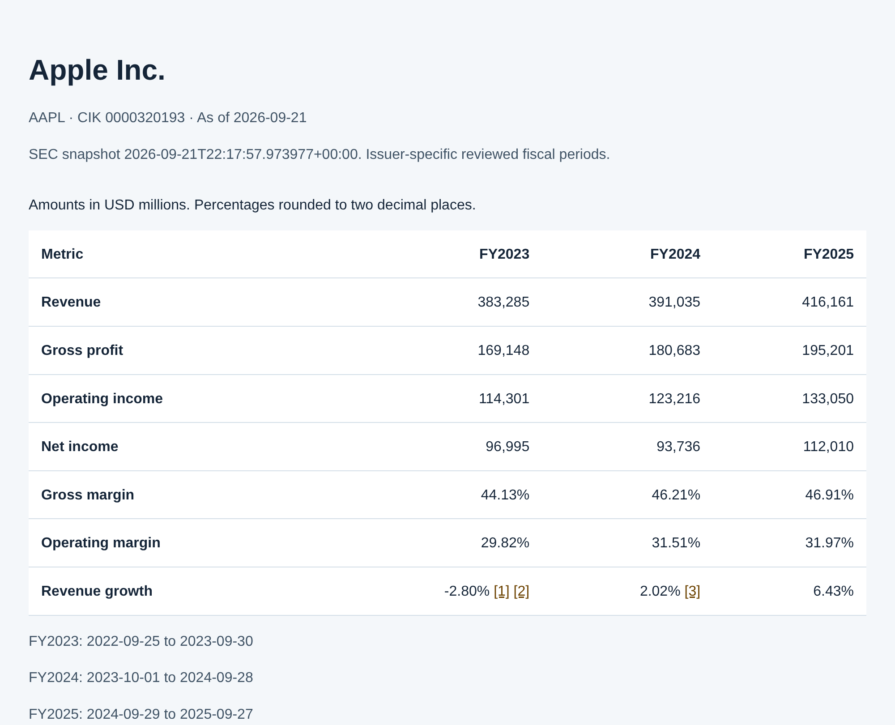

# Financial metrics analyst: source-backed financial answers in T3

[](https://github.com/RahilBhavan/financial-metrics-analyst/actions/workflows/ci.yml) [](LICENSE)



Ask financial questions in T3 using the provider account you already have. The current T3 model interprets your question; local Python tools return reviewed SEC facts and treasury figures, then rerun the selected calls and render a source-backed answer. **No separate model API key or MCP setup is needed.** See [docs/t3.md](docs/t3.md).

The runtime uses the Python standard library. Every financial number carries filing provenance, and the calculation tools call no model. An optional MCP stdio server and external-model adapters remain available for compatibility.
## What it does

- **T3-native workflow.** A project skill calls validated local tools directly. Financial answers are rendered from re-executed evidence selections; model-written numbers and copied result values cannot supply an answer.
- **Optional MCP server.** MCP 2025-11-25 over stdio, without the MCP SDK. It has 7 tools with closed input and full nested output schemas: 4 SEC tools (`resolve_company`, `get_annual_facts`, `get_quarterly_facts`, `calculate_metrics`) and 3 read-only treasury tools.
- **SEC coverage.** Revenue, gross profit, operating income, net income attributable to the issuer, gross margin, operating margin and revenue growth, plus annual operating, investing and financing cash flow for 10 issuers: FY2023–FY2025 each, plus FY2026 for Microsoft and NVIDIA. Each issuer also has its 4 latest reviewed 10-Q quarters (40 in all). A metric the issuer's income statement does not report (gross profit for Coinbase, Robinhood, PayPal and Visa; operating income for Robinhood) is returned as unavailable, never zero.
- **Refuses rather than guesses.** "Microsoft profit 2025" returns `needs_clarification` (exit 3). An unsupported metric returns `refused` (exit 2). A newer conflicting filing blocks a stale value. The Kraft Heinz reference case flags FY2017 operating income restated from $6,773M to $6,057M.
- **Treasury-analyst agent (optional).** A Claude tool-use loop over the server. The model proposes tool calls and selects evidence. The application renders financial answers from validated records; it does not accept model-written financial prose.

| Check | Result | Source |
| --- | --- | --- |
| T3-native integration | 6 / 6 checks pass, no project MCP setup or separate API key | `reports/t3-smoke.json` |
| Source and intent evaluation | 1,226 / 1,226 cases pass | `reports/evaluation.json` |
| Unit tests | 200 run, 199 pass, 1 skipped | `python3 -B -m unittest discover -s tests` |
| Official `mcp==1.30.0` SDK interoperability | 37 / 37 checks pass | `reports/sdk-smoke.json` |
| Agent: correct tool and arguments, 42 in-scope tasks | 42 / 42 | `reports/agent-eval.json` |
| Agent: out-of-scope refusals, false refusals | 8 / 8, 0 | `reports/agent-eval.json` |
| Agent: numbers in delivered answers traced to a tool result | 368 / 368; 1 answer withheld | `reports/agent-eval.json` |

The historical agent results above come from one run of a frozen 50-task set on 2026-10-21 with `claude-haiku-5-5` through the Claude Code CLI, at a mean cost of $0.0013 per task. [docs/treasury-agent.md](docs/treasury-agent.md) has the full table and known failures.

The new two-repeat development evaluations passed all **72/72 in-scope runs** (60 issuer/quarter/cash-flow runs and 12 open-wording runs), with 427/427 delivered numeric/source tokens traced. The initial strict refusal score was 14/16: two safe quarterly-cash-flow denials had an ordinary answer status. After adding explicit clarification/refusal status handling, a separate two-run recheck passes 2/2. The original failure records remain in place. See [docs/treasury-agent.md](docs/treasury-agent.md).

A fresh run of the original task file with the current agent passes 42/42 financial tasks and 8/8 refusals (`reports/agent-current/`); the original October 21 results remain unchanged. Treasury evidence includes every public numeric field, including mNAV, holdings, diluted shares and preferred-price gaps. Six indirect-injection runs introduce instructions into schema-valid issuer names and action notes: all keep the injected text out of delivered answers; five pass the strict end-to-end check, while one correct answer omits an expected optional action filter (`reports/agent-tool-injection/`).

## How it works

- `policy.py` defines the reviewed issuers, fiscal periods and approved US-GAAP tags.
- `domain.py` selects one fact per period from the bundled SEC snapshots by exact dates, tag, form and filing cutoff, records rejected candidates and revisions, and computes exact rational ratios.
- `contracts.py` and `tools.py` define the tools and validate every output; invalid output becomes an `invalid_tool_output` refusal.
- `server.py` is the stdio JSON-RPC server; `client.py` drives it as a subprocess for the CLI.
- `treasury.py` serves the frozen dat-accretion export.
- `agent.py` runs the model loop; `tracing.py` checks each number in a draft answer against the run's tool results.

All modules live in `financial_metrics/`.

## Run it

You need Python 3.9 or newer. The server, CLI and tests need no packages, account, API key or network.

```sh
git clone https://github.com/RahilBhavan/financial-metrics-analyst
cd financial-metrics-analyst
python3 -B -m unittest discover -s tests
python3 -B -m financial_metrics smoke
python3 -B -m financial_metrics demo
```

The current local Python 3.14.7 run has 200 tests with one skip; CI runs Python 3.9, 3.11 and 3.13. The skipped test rebuilds the treasury snapshot and runs only when `DAT_ACCRETION_REPO` points at a dat-accretion checkout.

More commands:

```sh
python3 -B -m financial_metrics analyze --ticker NVDA --as-of 2026-02-25   # every reviewed NVIDIA year
python3 -B -m financial_metrics analyze --ticker NVDA --quarter Q2          # latest reviewed Q2, labeled Q2 FY2027
python3 -B -m financial_metrics ask 'Microsoft profit 2025'   # needs_clarification, exit 3
python3 -B -m financial_metrics.evaluate                      # 1,226 cases; rewrites files in reports/
```

To use the server from an MCP host, point the host's stdio configuration at `server_stdio.py` (it also works under `python -P`), or run `pip install -e .` for `financial-metrics` and `financial-metrics-mcp` commands. Use an editable install: the snapshots in `data/` are not packaged. See [docs/mcp-server.md](docs/mcp-server.md) for the configuration and the SDK check, which needs Python 3.10 or newer and `requirements-sdk-test.txt`.

The optional standalone agent needs a Claude model; T3-native use does not. Set `ANTHROPIC_API_KEY` for the Messages API backend, or have a signed-in `claude` CLI for the `claude-code` backend:

```sh
python3 -B -m financial_metrics.agent --backend claude-code "What is BitMine's BMNP break-even price?"
```

A cash-flow report with expandable filing evidence is in [reports/cash-flow-demo.html](reports/cash-flow-demo.html).

Additional verification commands (live model commands use account credit):

```sh
python3 -B -m financial_metrics ask 'Apple operating cash flow 2025'
python3 -B -m financial_metrics.agent_eval --tasks evals/agent-expanded-tasks.json --repeats 2 --out-dir reports/agent-expanded
python3 -B -m financial_metrics.agent_eval --tasks evals/agent-open-tasks.json --repeats 2 --out-dir reports/agent-open
python3 -B scripts/verify_host.py       # signed-in Claude Code, native MCP integration
python3 -B scripts/verify_api.py        # ANTHROPIC_API_KEY required; missing key exits 2
```

For normal use, open the project in T3 and ask a question. `AGENTS.md` and the project skill describe the direct workflow. The optional API smoke is not a delivery requirement for this route.

## Repository layout

- `financial_metrics/`: the direct T3 CLI, optional MCP server, selection logic, tools, agent and evaluations.
- `server_stdio.py`: the absolute-path launcher for MCP hosts.
- `data/`: SEC snapshots with manifests and ground-truth cards, plus the treasury export.
- `evals/`: the frozen agent tasks and the separate development questions.
- `tests/`: unit and subprocess tests.
- `reports/`: committed demo reports, evaluation results, SDK check output and agent transcripts.
- `scripts/`: report regeneration, the SDK check, the filing review tool, the treasury export and the transcript renderer.
- `docs/`: methodology, server and agent documentation, and source research.
- `.github/workflows/`: lint (pyflakes), tests on Python 3.9, 3.11 and 3.13, the SDK check and the treasury snapshot rebuild.

## Documentation

- [docs/t3.md](docs/t3.md): use the current T3 model with local verified tools, without MCP setup or a separate API key.
- [docs/methodology.md](docs/methodology.md): fact selection and accounting rules, expected values, the Kraft Heinz case, CLI exit codes, proposals and the SEC refresh.
- [docs/mcp-server.md](docs/mcp-server.md): protocol, tool list, host configuration and the SDK interoperability check.
- [docs/treasury-agent.md](docs/treasury-agent.md): the agent loop, the number gate, the treasury tools and the 50-task evaluation with known failures.
- [docs/issuer-expansion-research.md](docs/issuer-expansion-research.md): primary-source evidence for Microsoft FY2026 and NVIDIA.
- [EVALUATION.md](EVALUATION.md): the 1,226-case evaluation by group, reproduction commands and remaining limits.
- [WALKTHROUGH.md](WALKTHROUGH.md): one answer traced through the code, in reading order.
- [IMPROVEMENT-PLAN.md](IMPROVEMENT-PLAN.md): the September 2026 reliability plan and its completion evidence.

## Sources

- SEC companyfacts and submissions API responses, stored unmodified in `data/`. Apple, Microsoft and Kraft Heinz were captured on 2026-09-21, NVIDIA on 2026-09-22 and the seven added issuers on 2026-10-25. Each `manifest.json` records source URLs, byte counts and SHA-256 hashes.
- Ground-truth cards (`data/*/ground-truth.json`) are transcriptions from the issuers' 10-K, 10-Q and annual-report filings, linked in [EVALUATION.md](EVALUATION.md). The seven added issuers' cards, and every issuer's quarters, are read from the filing documents' income statements by `scripts/review_filings.py`, which never opens companyfacts.
- Annual cash-flow cards (`data/*/cash-flow-ground-truth.json`, plus Apple at the data root) are independent visible-statement transcriptions by `scripts/review_cash_flows.py`, covering 93 signed USD values.
- Treasury data is a frozen export of dat-accretion commit `ce3b715`, weeks 2026-05-31 to 2026-10-11. It is built from 8-K and 10-Q filings plus CoinGecko and Yahoo daily closes; CI rebuilds it and requires byte equality.

## Scope and limits

- Independent portfolio work, not affiliated with the SEC, Anthropic or any issuer named here.
- Coverage is bounded: 10 issuers, reviewed annual periods and 4 reviewed 10-Q quarters each. The SEC API held no facts for the PayPal and Visa 10-Qs filed in July 2026, so those quarters are not reviewed. Other quarters, quarterly cash flow, capital expenditures, free cash flow, EBITDA, valuation, IFRS and currency conversion are unsupported. JPMorgan is outside the reviewed issuer policy. Snapshot files are limited to 32 MiB each.
- The frozen 21 October agent evaluation describes the old prompt. The current prompt derives all ten issuers and their periods from policy; separate expanded and open-wording evaluations live in `reports/agent-expanded/` and `reports/agent-open/`.
- The SDK check is interoperability evidence with one second client, not protocol certification or a test in each desktop host.
- The new development evaluations repeat each task twice and include broader wording and adversarial requests. This small sample is not a general robustness claim. The optional Messages API backend has not been run live; `scripts/verify_api.py` records this as `not_run` when no key is available.
- Filing-date filtering does not recreate past API contents. A changed value is flagged as a revision, not classified as a restatement without a source.
- The 26 October live refresh passed all ten annual issuer checks and all 40 reviewed quarters, including annual cash flows (`reports/live-refresh-ten-issuers.json`). The native Claude Code MCP host passed 4/4 checks (`reports/host-smoke.json`); other desktop hosts remain untested.

## License

[MIT](LICENSE). The license covers this project's code, not SEC filings, issuer reports or third-party market data.

Part of [Rahil Bhavan's projects](https://github.com/RahilBhavan).
